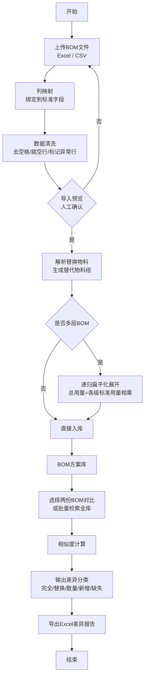
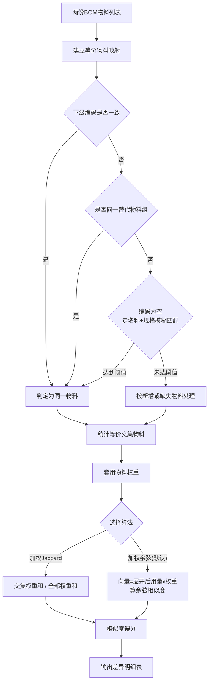

# BOM 相似度对比工具 · 需求文档（一页版）

## 一、项目目标

搭建一套 BOM 方案库，把整份 BOM 导入并入库。用户上传新 BOM 后，可以和库内已有 BOM 做相似度比对、差异分析。主要用在：方案复用、新 BOM 查相似历史方案、版本变更核对。

## 二、固定 BOM 明细字段

| 字段        | 作用          |
| --------- | ----------- |
| 下级BOM     | 标识层级，用于展开   |
| 下级编码      | 核心匹配主键      |
| 名称、规格     | 无编码时做模糊匹配   |
| 单位        | 仅展示，不做换算    |
| 标准用量      | 用量计算唯一来源    |
| 损耗率       | 仅展示，不参与任何计算 |
| 替换物料      | 生成等价物料组     |
| 获取途径、发料中心 | 仅展示，不参与打分   |

## 三、核心业务约定

1. 损耗率不管空还是填了，一律不参与计算和打分。
2. 用量只取标准用量。多层 BOM 展开时，总用量 = 各级标准用量逐层相乘。
3. 匹配优先级：下级编码 > 替代物料组 > 名称+规格模糊匹配。
4. 获取途径、发料中心不参与相似度打分，可配置开关，选择是否标记差异。
5. 单位不换算，单位不一致时交人工复核。
6. 相似度分数只做参考，等价物料判定结果需人工复核。

## 四、功能需求

### 1. BOM 方案库管理

- 库里存整套 BOM 方案，不存零散物料。
- 方案信息：名称、版本、备注、创建时间、是否已扁平化。
- 明细保留全部字段，另存展开后的总标准用量。
- 替代物料组独立管理，支持自动解析 + 手动新增、修改、合并，处理循环引用。

### 2. BOM 导入与清洗

- 支持 Excel(xlsx)、CSV。
- 列映射：用户把文件列绑定到固定字段，映射方案可存为模板。
- 清洗：去空格、统一大小写与符号、跳过空行/合计行/注释行、标记异常行（编码为空、规格为空）。
- 导入预览：确认无误后才入库。

### 3. 相似度与差异比对

- 物料权重可配置（主控高、普通阻容低、紧固件最低）。
- 两种算法可切换：加权 Jaccard、加权余弦相似度（默认）。
- 差异分为 5 类：完全匹配、等价替换匹配、数量变更、新增物料、缺失物料。
- 附加差异（开关控制）：获取途径变更、发料中心变更。
- 上传新 BOM 可批量对比全库，返回 TOP N 最相似方案。

### 4. 结果展示与导出

- 汇总：相似度百分比、对比方案名称、对比时间。
- 差异明细表格，带全部字段和展开后用量。
- 高权重物料发生新增/缺失/替换时重点标红。
- 导出 Excel 差异报告。

## 五、约束与风险

- MVP 先做单层 BOM，多层递归展开放二期。
- 替代物料文本格式杂乱，手动维护替代组是必需功能。
- 需做循环嵌套 BOM 检测，防止展开卡死。

## 六、迭代路线

- 一期：导入入库、替代组维护、两两对比、参数配置、差异导出（单层）。
- 二期：多层自动展开、全库批量检索、差异项开关、版本管理。
- 三期：物料自动分类、大模型辅助复核、对接 PLM/ERP。

---

# 流程图（Mermaid）

## 图 1 · 整体流程

## 图 2 · 相似度计算流程

