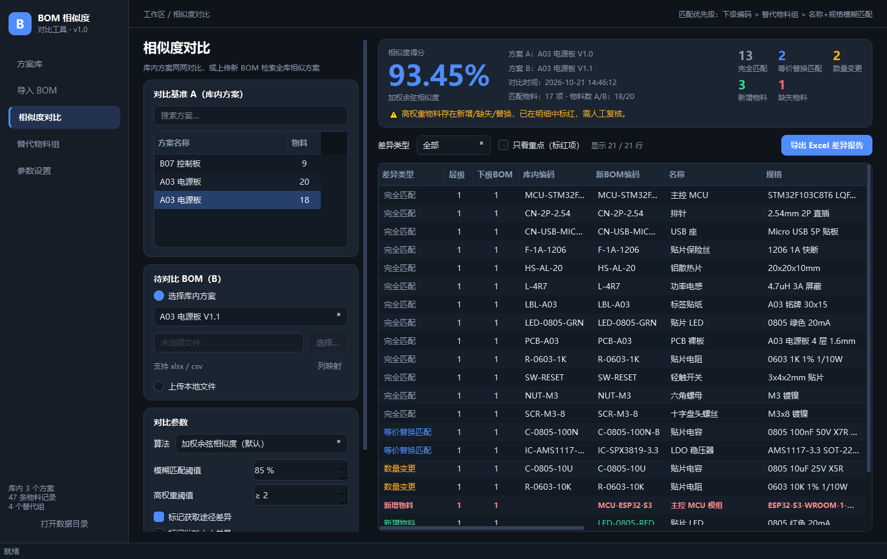
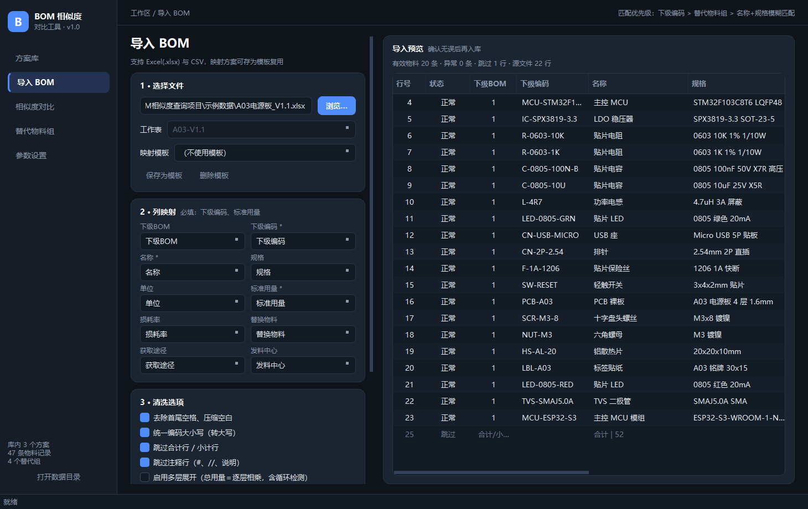
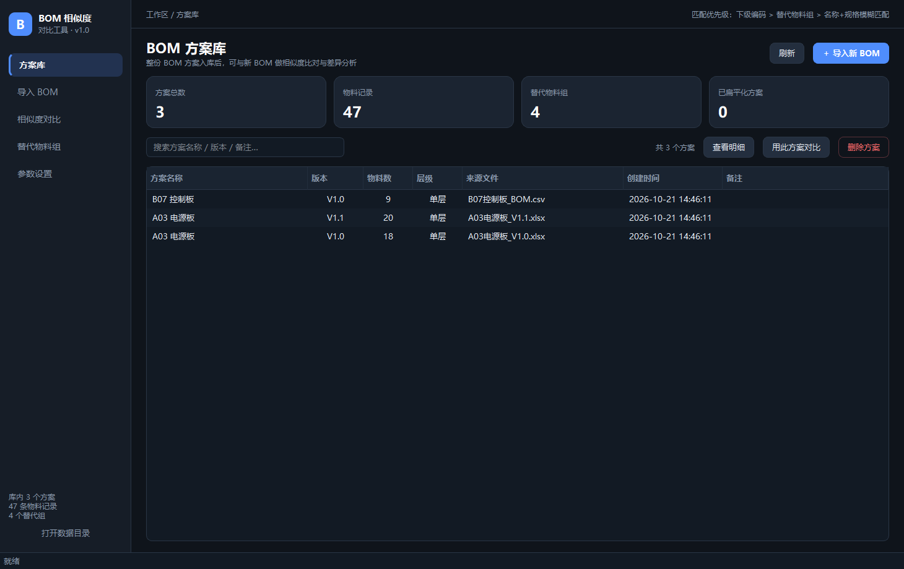
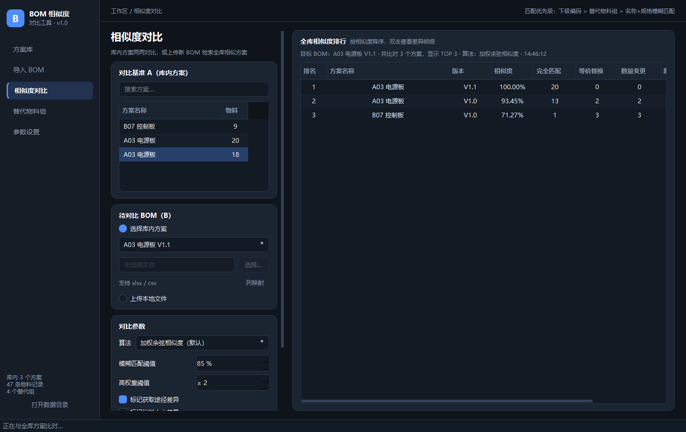
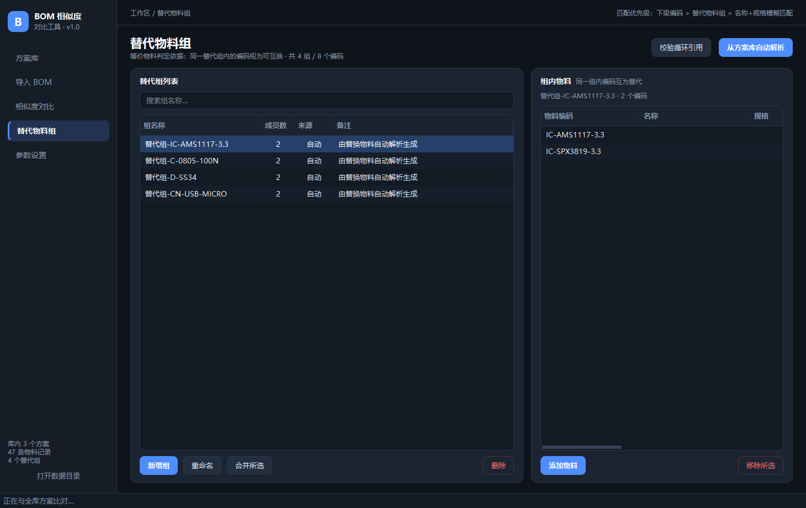
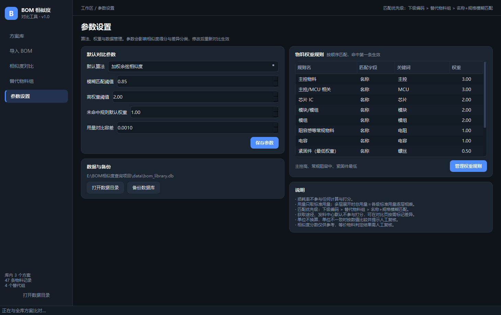

# BOM 相似度对比工具

> 面向制造业 BOM（物料清单）的方案库与相似度比对工具：整份 BOM 入库，新 BOM 一键查相似历史方案、做版本差异核对。

Windows 桌面应用，免安装单文件 exe。深色界面，本地 SQLite 存储，数据不出本机。

## 下载

前往 [Releases](https://github.com/rockyanyan/bom-similarity-tool/releases/latest) 下载：

| 文件 | 说明 |
| --- | --- |
| `BOM-Similarity-Tool-v1.0.0.exe` | 程序本体，免安装，约 39 MB |
| `demo-data.zip` | 演示 BOM 数据，解压后可直接导入 |

> Windows 首次运行若提示「已保护你的电脑」，点「更多信息 → 仍要运行」即可（未做代码签名）。

## 界面预览

**相似度对比** — 加权得分、差异分类统计、高权重物料标红，支持导出 Excel 差异报告：



**导入 BOM** — 列映射、清洗选项、异常行标记、入库前预览：



**BOM 方案库** — 整份 BOM 入库，统计面板 + 方案检索：



**全库批量检索** — 上传新 BOM 一键对比全库，TOP N 排行：



**替代物料组** — 自动解析 + 手工维护等价物料：



**参数设置** — 算法参数与物料权重规则：



## 功能

**BOM 方案库**
- 整份 BOM 方案入库（名称、版本、备注、创建时间、是否扁平化），明细保留全部标准字段与展开后总用量
- 方案明细查看、导出 Excel

**导入与清洗**
- 支持 Excel（.xlsx/.xlsm）与 CSV，自动识别表头行与编码
- 列映射：把文件列绑定到 10 个标准字段，映射方案可存为模板复用
- 清洗：去空格、统一编码大小写、跳过空行/合计行/注释行、标记异常行（编码为空、规格为空、用量无法解析）
- 入库前预览确认，异常行标红
- 多层展开：总用量 = 各级标准用量逐层相乘，含循环嵌套检测（不会卡死）

**替代物料组**
- 导入时自动解析「替换物料」文本生成等价物料组
- 手工新增 / 修改 / 合并 / 删除，自动解析采用增量合并，不覆盖手工维护的组
- 循环引用校验（自引用、跨组重复、BOM 层级嵌套）

**相似度与差异比对**
- 匹配优先级：**下级编码 > 替代物料组 > 名称+规格模糊匹配**
- 两种算法可切换：加权余弦相似度（默认）、加权 Jaccard
- 物料权重规则可配置：主控 3.0、芯片 2.0、常规阻容 1.0、紧固件 0.5（可增删改）
- 差异分类 5 类：完全匹配、等价替换匹配、数量变更、新增物料、缺失物料
- 附加差异开关：获取途径变更、发料中心变更（默认不参与打分）
- 高权重物料发生新增/缺失/替换时自动标红
- 上传新 BOM 批量对比全库，返回 TOP N 最相似方案

**结果导出**
- Excel 差异报告：汇总页（相似度、分类统计、复核提示）+ 差异明细页（全字段、配色、筛选）

## 业务约定

| 约定 | 说明 |
| --- | --- |
| 损耗率 | 无论是否填写，一律不参与计算与打分 |
| 用量 | 只取标准用量；多层展开时逐层相乘 |
| 单位 | 不做换算，单位不一致时提示人工复核 |
| 获取途径 / 发料中心 | 默认不参与打分，可开关决定是否标记差异 |
| 相似度分数 | 仅供参考，等价物料判定结果需人工复核 |

## 快速开始

1. 下载并双击 `BOM-Similarity-Tool-v1.0.0.exe`（首次运行会在同级目录创建 `data/bom_library.db`）
2. 「导入 BOM」选择文件 → 确认列映射 → 预览清洗结果 → 填写方案名称后入库
3. 「相似度对比」左侧选择库内方案 A，右侧选库内方案或上传新 BOM，点「开始对比」
4. 查看差异明细，按需「导出 Excel 差异报告」
5. 也可「批量对比全库」获取 TOP N 相似方案排行

仓库 `示例数据/` 内置演示文件，可直接导入体验：
- `A03电源板_V1.0.xlsx` / `A03电源板_V1.1.xlsx`：包含数量变更、等价替换、新增、缺失、获取途径变更
- `B07控制板_BOM.csv`：另一块板，用于全库批量检索

## 技术栈

- Python 3.13 + PySide6（Qt6，Fusion + 自定义深色 QSS）
- SQLite（`sqlite3`，便携式本地库）
- openpyxl（Excel 读写、差异报告导出）
- PyInstaller（单文件窗口程序打包）

## 项目结构

```
main.py                 程序入口
app/core/
  db.py                 SQLite 表结构与 DAO
  importer.py           Excel/CSV 读取、列映射、清洗、多层展开
  engine.py             匹配、加权余弦/Jaccard、差异分类
  exporter.py           Excel 差异报告与明细导出
  textutil.py           文本归一化、数值解析、模糊相似度
app/ui/
  main_window.py        主窗口与导航
  page_library.py       方案库
  page_import.py        导入与清洗
  page_compare.py       相似度对比 / 批量检索
  page_alt.py           替代物料组
  page_settings.py      参数设置、权重规则、备份
  dialogs.py            列映射、明细、权重、成员对话框
  theme.py  common.py   深色主题与通用组件
tools/
  gen_assets.py         生成图标与演示数据
  smoke_test.py         核心算法冒烟测试
  ui_snapshot.py        离屏渲染界面截图自检
示例数据/                演示 BOM 文件
```

## 本地开发

```bash
python -m venv .venv
.venv\Scripts\pip install PySide6-Essentials openpyxl pyinstaller

.venv\Scripts\python main.py            # 运行
.venv\Scripts\python tools\smoke_test.py # 算法冒烟测试
```

打包 exe：

```bash
.venv\Scripts\pyinstaller --noconfirm --clean --onefile --windowed ^
  --name "BOM相似度对比工具" --icon assets/app.ico ^
  --add-data "assets;assets" --hidden-import openpyxl main.py
```

## 数据与备份

- 数据库位于 exe 同级 `data/bom_library.db`，迁移时整体拷贝文件夹即可
- 「参数设置 → 备份数据库」可导出快照；数据库为标准 SQLite，可用任意工具查看

## 迭代方向

- 二期：多层自动展开全流程、全库批量检索增强、差异项开关细化、版本管理
- 三期：物料自动分类、大模型辅助复核、对接 PLM / ERP

## 说明

演示数据均为虚构样例，不含任何真实企业 BOM 数据。
